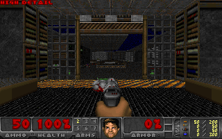
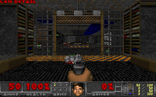

# Quality selection

`--runtime-detail` is opt-in and uses one engine binary. With `--low-detail`, it
starts low; without it, it starts high. Then F5, the browser **Toggle detail**
button, or Doom's Options menu owns the setting. No restart/recompile is needed.
The renderer's actual detailshift is recorded when CPU profiling is enabled.
High/low selection does not alter simulation tics, enemies, framebuffer ownership,
DMA pinning, STOP, guards or full audits.

The fixed `--low-detail` build remains available for matched benchmarks. Do not
use the runtime toggle during a fixed-input FPS comparison. `--detail-test` and
`--column-test` cannot be combined with runtime selection: their mode schedules
are strictly checked. The bounded ping-pong benchmark deliberately rejects keys;
its page is not an interactive quality test. Runtime selection needs an interactive
session (or a separate, explicitly scripted acceptance test).

Native validation injects F5 down/up at frames12 and24, asserts low/high/low at
frames 10,20,32, repeats deterministically and tests STOP/heap cleanup at40. The bounded card acceptance injects F5 down/up after frames 20 and 32 and checks
actual renderer detail at frames 10,28,40. Its frame replay also requires those
exact control events. Card acceptance is tracked separately from fixed-column
FPS measurements, and this mode never relaxes full system/ownership audits.

Future flat-floor, reduced-view or alternative-fuzz experiments must keep normal
rendering available and get independent controls. Do not silently turn them on.

## Card result

The successful 100-frame card run uses one runtime image. Actual detailshift is
1 at frame 10, 0 at frame 28, and 1 at frame 40 after F5 down/up pairs following
frames 20 and 32. All 45 paired system audits, ownership checks, stalled-host and
held-frame STOP/drain checks pass. All 24 frame and four drain mutations are
rejected after correcting the existing short-run STOP-metadata precedence bug.
90 observed HTTP frames match the captured bytes exactly. This mixed-quality run
is explicitly marked unsuitable for an FPS comparison.

The native 40-frame test also repeats deterministically with STOP/drain. The
initial host-harness exception and its regression test are retained in the main
report. These results prove live switching, not high-detail performance across
all scenes. The bounded ping-pong page hides the interactive button and exercises
F5 through the normal bounded input channel; interactive builds expose the button.

