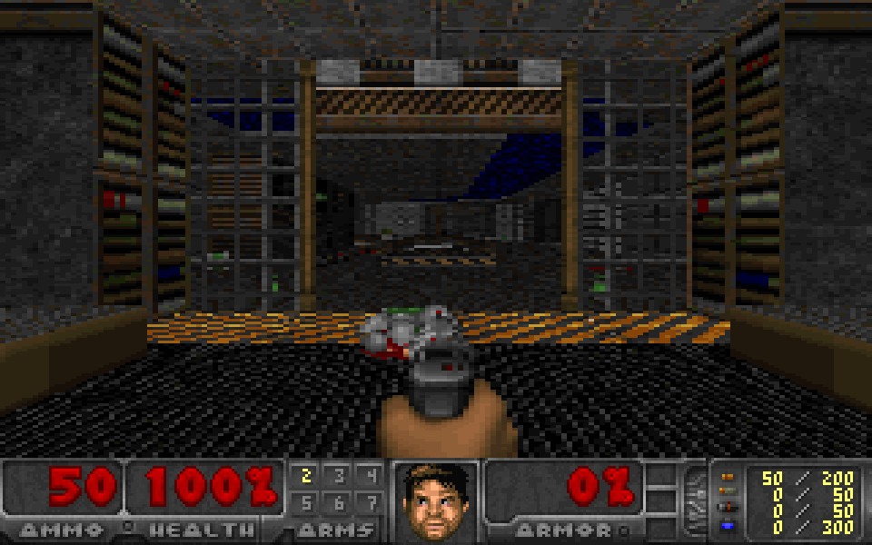
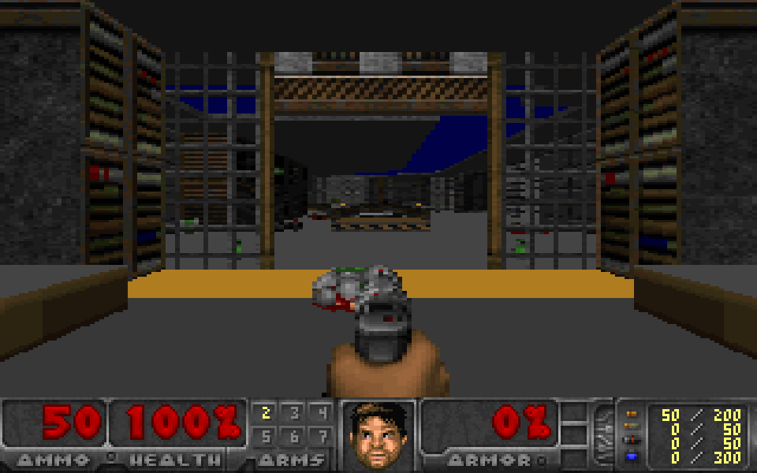

# AcceleRAID 160 optional flat floors and ceilings — 2026-10-18

The old card's shared `--runtime-flat` renderer is now exposed by the new-card
builder and browser. It starts **textured**. F6 or **Toggle flat planes** switches
at the normal input boundary, without reallocating render/DMA buffers. The button
reports validated card telemetry, not a predicted host-side state. Builds without
the feature hide the button and reject F6 through the browser API.

Sky, walls, sprites, HUD, sector lighting and span clipping retain their paths.
Flat mode uses each plane texture's first palette index through the sector light
table. It removes floor/ceiling texture detail and distance shading. Low-detail
columns remain the accepted default; half-height is not enabled. Firmware and DMA
ownership policy are unchanged. Full audits, host FNV/SHA, source/marker/ACK checks,
private heap cleanup, IRQ/cache/owner checks and stale-rearm gates remain enabled.

## Predeclared comparison

One admitted persistent engine, four fresh games in one reusable RTEMS instance:
**textured / flat / flat / textured**, 128 frames per game. Each image starts with
zeroed mode state. Game 1 injects F6 down/up after frames 8 and 20 to prove on/off
switching. Games 2/3 inject it after frame 8; game 4 remains textured. Keyboard
input from the browser is excluded from the automated comparison. Published mode
and switch-count telemetry must agree by frame 32.

The first 32 frames of **each** game have complete independent PIO/DMA comparisons.
The measured window is local frames **40–119**, 80 samples and 79 interframe
intervals per game. It excludes initial wipes, mode transitions and extra PIO
work. Camera, map, skill, engine, cache mapping, checksums, card/host buffers and
audit policy stay fixed. This is a stationary E1M1-spawn comparison, not a timedemo
or a claim across every scene. CPU attribution is timer-sampled at 10 ms; averages
are useful, individual-frame cycle precision is not claimed.

The earlier 11.5–12 FPS projection predates the new card's accepted cache mapping.
The current cached baseline is around 17 FPS. Use the actual matched measurements
below when available, not a proportional estimate from the old card.

## Measured card results

| Mode | Card FPS | Renderer wall time | Plane wall time | Renderer CPU samples × 10 ms |
| --- | ---: | ---: | ---: | ---: |
| Textured | 17.975 | 49.00 ms | 13.81 ms | 49.00 ms |
| Flat | 22.129 | 38.06 ms | 2.44 ms | 38.13 ms |

**+23.109% FPS**, about **10.94 ms less renderer work** and **11.38 ms less
plane work**. Textured repeats: 17.9954 / 17.9545 FPS. Both flat repeats:
22.1289 FPS. Plane CPU attribution averages 13.75 vs 2.44 ms. Timing is sampled
at 10 ms, averaged across the declared windows; no cycle-accurate claim is made.
These are card generation/delivery rates, not browser paint FPS or input latency.

All **512 frames**, **128** complete PIO/DMA comparisons, three fresh-image
rearms, **20** stale rearm rejections, four retired-entry rejections and final
STOP/heap/IRQ/cache/owner/DMA audits pass. All **20,180** engine WAD reads replay
against immutable source bytes and the first 5,043 requests in every game match
the native startup oracle. All **27** sampled HTTP payloads match captured
frames and quality metadata. Four deliberate capture mutations are rejected.

Two 52-frame native comparisons replay the observed normal/flat/normal and
normal/flat quality sequences. All 104 pictures retain exactly the same four
known pixel differences, with no added differences. Native repeats, mode
telemetry, cleanup and full frame/guard checks pass. The visually inspected
PNGs below come directly from same-local-frame card captures (frame 80), with
nearest-neighbor scaling; they are not browser screenshots.




`comparison.json` and `verify.py` hold the measurements and independent replay.
`acceptance-pre-reset.tar.xz` contains the complete current captures, pre-flash
pair, exact kernel/engine/relocations/modules and tested host sources, private
host engine and native oracle pictures/reports. The pinned WAD is reused from
`artifacts/doom-m1-20261011`, not duplicated. Native oracle source is in the repo
and its exact generated C is included beside the native pictures.

**Final paired post-reset flash reads are pending.** The ordinary launcher is
unchanged. An optional wrapper is prepared but no new card execution was started:

```sh
I960_DOOM_LAUNCHER=/home/mit/.local/bin/i960-doom-flat ./doom
```

After the acceptance reset, open `http://192.168.2.75:8087/`, click the canvas
for keyboard focus, and press **F6** or click **Toggle flat planes**. The image
starts textured; the button shows confirmed card state. F6 switches back to
textures in the same game and build. Normal movement/fire/use controls are
unchanged. The reusable idle/rearm semantics remain: game Stop/Quit parks the
engine, while explicit `shutdown` is terminal/reset-only. Positive browser/CLI
restart after sustained idle and idle host-loss remain separate qualification
work from the accepted automatic rearm/F6 path here.

## Reproduction

Workspace `/home/mit/i960-flat-accele160-20261018`; source snapshot under `source/`,
full build under `build/`, pinned bundle under `bundle/`.

```sh
python3 game/doom/play/accele160/build.py --runtime-flat --reusable \
  --work NEW_DIRECTORY --archive PINNED_DOOM_SOURCE \
  --newlib PATCHED_NEWLIB --rtems-build ACCEPTED_RTEMS_BUILD
```

Generate the persistent manifest and provision as in the AcceleRAID play README.
The acceptance command uses:

```sh
sudo -n python3 /home/mit/i960-flat-accele160-20261018/bundle/project/game/doom/play/accele160/launch.py \
  --bundle /home/mit/i960-flat-accele160-20261018/bundle --port 8087 \
  --restart-cycles 4 --max-frames 128 --flat-benchmark \
  --paired-frames 32 --capture-all
```

Native tests: 41,088 guarded fill cases, patch/telemetry/admission checks; 40-frame
real input/normal-flat-normal deterministic repeat and STOP/heap drain; browser
F6 debounce/confirmed telemetry/fresh-game reset. The native comparison retains
exactly the known four pre-existing differences at 29260, 29261, 29580, 29581.
They are not introduced by the flat mode and are not silently ignored.

The new admission is **873,980 bytes** within the unchanged 900,000-byte image
budget. The ordinary launcher has not been replaced during this experiment.
