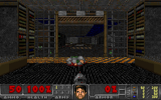
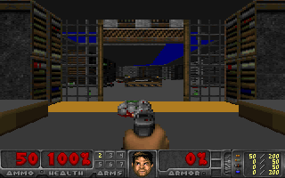

# Flat planes — physical acceptance, 2026-10-16

Implementation: [flat planes](../../../game/doom/flat_planes/README.md).
This experiment uses one i960 engine with runtime F6 switching, not separately
compiled quality variants. Textures are enabled initially. Sky, walls, sprites,
HUD, DMA ownership and full audits retain their existing paths.

## Predeclared comparison

A 520-frame low-detail run enables exact fast FixedDiv (play default), C columns,
two-sample fast renderer, direct presentation/no FNV, WAD ring/profile,
peer-yield and priority ping-pong release. Full audit interval remains 3 seconds.
F6 is injected at frames 20, 32, 220 and 420 through the normal bounded input FIFO.
The first pair checks transitions; the later pair supplies steady
textured/flat/flat/textured windows 141–218 / 241–318 / 341–418 / 441–518.
A level reload at frames 60/62/64/66 precedes the measured windows.

This is a same-session, same-build experiment. It reduces reboot/build variance
but does not prove performance across levels or sustained interactive sessions.
The generic mixed-quality transport FPS comparison is explicitly invalid; use
`measure.py` and its separate windows. No audit or ownership validation is removed.

## Reproduction and retention

Remote workspace: `/home/mit/i960-flat-20261016`, project snapshot under `project/`.
`build.sh` records the exact host/i960 build recipe, `run.sh acceptance` the launch,
and `verify.sh acceptance build` the full system/frame/WAD and mutation checks.
A fresh checkout can instead build the same feature/validation configuration with:

```sh
python3 game/doom/play/build.py --work NEW_DIRECTORY --runtime-flat \
  --pipeline --pingpong --wad-ring --wad-profile --peer-yield \
  --frame-profile --cpu-profile --low-detail --no-fnv --direct-frame \
  --fast-render --fast-columns
```

The work tree was seeded with pinned Newlib/source archives and Freedoom from the
accepted span experiment, then compiled from the current source. It requires the
pinned DoomGeneric archive and loader runner at their normal repository paths.
Full audits/captures are retained for this current acceptance; duplicate dependency
build trees and intermediate failed compile outputs are not added to Git.

Host tests passed: 41,088 guarded fills; actual debounce; metadata/refusal checks;
40 real interactive native frames with normal/flat/normal transitions, STOP/drain
and deterministic repeat; 52 normal native frames identical to the accepted
pre-feature baseline. Linux's adapter test passes 320 ownership/presentation cases.
The 32-bit adapter test requires Linux multilib; it does not link on this ARM Mac.

## Accepted measurements

| Mode | FPS | Renderer | Planes | Renderer CPU samples × 10 ms |
| --- | ---: | ---: | ---: | ---: |
| Textured | 6.4541 | 135.513 ms | 40.962 ms | 133.205 ms |
| Flat | 7.8770 | 107.308 ms | 13.462 ms | 105.192 ms |

**+22.046% FPS**, about **28.2 ms less renderer time** and **27.5 ms less plane
rendering**. Textured repeats: 6.4758 / 6.4326 FPS; flat repeats: 7.8972 / 7.8568.
BSP and sprite times remain close. Observation-to-HTTP availability is 4.945 vs
5.669 ms: there is no demonstrated transport-latency improvement. The gain comes
from reduced renderer work. This does not establish 10 FPS or input-to-paint time.

520 frames and **56 full paired audits** pass, including stalled host with both
slots unchanged, held-slot STOP, heap drain and dual-stack traffic. Maximum IRQ
gap: **10.734 ms**. Remote and local system/frame/WAD replays pass. The frame
mutation suite rejects 24 corruptions; drain replay rejects four. All **479**
received HTTP payloads match their exact captured frames. Browser Canvas output
was inspected in both modes.

52 repeated native oracle frames follow the actual card quality sequence and
match pixels/palette except the same four known differences at 29260, 29261,
29580 and 29581. The normal path also matches all 52 pre-feature native images.
Those pre-existing differences remain unresolved; they were not hidden or widened.
The new image uses **819,728 bytes** of the 900,000-byte admission budget.




## Files

`comparison.json`, `acceptance-summary.json`, the replay/mutation reports and
`native-verification.json` hold the compact results. `acceptance-card.tar.gz`
contains this one complete current audit/capture batch; `accepted-inputs.tar.gz`
contains its exact kernel, module, admitted engine and metadata (about 684 KiB).
Both archives were copied locally and SHA256-verified before reboot. Source is
in the repository; no repeated dependency or intermediate build archives are added.

For local replay, extract both archives in a fresh directory, supply the pinned
Freedoom WAD from `artifacts/doom-m1-20261011/freedoom-0.13.0.zip` as
`build/freedoom1.wad`, then run `rtems/residentnet/verify.py --root build
live-acceptance`, `rtems/residentnet/verify_play_pipeline.py live-acceptance` and
`rtems/dma/wad_ring/verify.py live-acceptance --wad build/freedoom1.wad`.

The experimental card session ended cleanly and the retained module was released
by reboot. The public IPv6 web service is restored: HTTP 200 from the Mac, 2891 bytes,
relay PID 2096, boot `822f72d7-8b2f-4a81-b041-b3cfbd384717`. See `restoration.json`.
No forced unload or flash write was performed.
