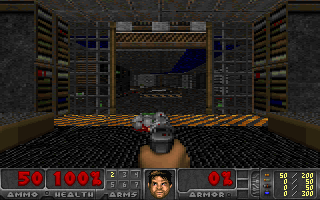

# BSP/plane rendering experiment — 2026-10-15

This continues the accepted release-priority baseline from commit `235a80b`.
The earlier ~107 ms BSP and ~58 ms plane measurements identify broad stages:
BSP includes wall rendering, and plane time includes mapping and span emission.
They are not isolated traversal-only or span-only cycle counts.

The opt-in `--fast-render` candidate enables an exact two-sample span kernel and
selective `-O2` for `r_bsp.c`, `r_plane.c`, `r_draw.c`. All other units retain
existing flags, including `R_PointOnSide -O0`. Fast memory is off in both builds.
The test groups these changes; it cannot attribute a gain uniquely to either
compiler flags or span code. Full audits and all ownership checks are unchanged.

## Validation and reproduction

`PLAN.md` predeclares 520-frame A/B/B/A runs, measuring frames100–499 with no
outlier removal. Each run uses priority delivery and the same scripted input,
WAD, detail level, full 3-second paired audit cadence, stall and STOP tests.
`accept.py` saves and hash-verifies every evidence archive before rebooting.
`build.sh`, `run.sh`, `verify.sh`, `archive.sh` record the isolated remote commands.
The temporary failed build from an incomplete source copy was discarded before
any card run; no result from it is used.

The new span primitive passes 82,176 ASan/UBSan cases. The complete native engine
passes 40 interactive frames with STOP/drain and two deterministic 52-frame runs.
All 52 pixels/palettes match the accepted native renderer. Card acceptance and
performance results follow below.

## Accepted result

Four 520-frame runs in predeclared **A/B/B/A** order passed. The complete
frames 100–499 windows contribute 800 frames  / 798 intervals per build; no pause
or outlier was removed. A is the unchanged accepted engine; B adds `--fast-render`.
Both use priority delivery, low detail, no per-frame CRC/FNV, the same WAD,
input sequence, DMA ownership checks and full three-second audit cadence.

| Run | Build | Delivered FPS | Renderer mean | Plane mean |
|---|---|---:|---:|---:|
| a1 | original | 4.834 | 187.325 ms | 57.825 ms |
| b1 | fast-render | 5.327 | 168.475 ms | 40.175 ms |
| b2 | fast-render | 5.341 | 167.875 ms | 39.875 ms |
| a2 | original | 4.829 | 187.950 ms | 58.000 ms |

| Matched aggregate | Original | Fast renderer |
|---|---:|---:|
| Delivered FPS | 4.831 | 5.334 |
| Card publication FPS | 4.831 | 5.334 |
| Frame interval (ms) | 206.976 | 187.487 |
| Renderer wall time (ms) | 187.637 | 168.175 |
| Renderer sampled CPU (ms) | 184.275 | 165.250 |
| BSP/wall stage (ms) | 108.312 | 106.500 |
| Planes (ms) | 57.913 | 40.025 |
| Sprites (ms) | 21.413 | 21.650 |
| Screen copy (ms) | 10.575 | 10.500 |
| Completion observed → HTTP available (ms) | 4.996 | 4.515 |
| Release gate wait (ms) | 2.687 | 2.686 |
| Release ioctl (ms) | 7.212 | 7.576 |

This is **+10.40% FPS** and **−10.37% renderer wall time**. Plane rendering time falls
by about 30.9% and accounts for most of the saving. BSP/wall time falls only
1.81 ms; the grouped experiment does not isolate traversal from wall drawing,
or span changes from compiler flags. Do not claim a separate large BSP speedup.
Sampled CPU corroborates the wall-time reduction (184.28→165.25 ms).

The sustained tested workload now exceeds 5.19 FPS. This is not a promise for
other views, WADs, levels or high detail. Keep the build flag opt-in for broader
interactive qualification. The prior release-priority improvement remains on;
validated latency/overhead improvements remain useful even without an FPS gain.

Latency definitions matter: HTTP availability is not browser receipt/paint.
DMA-start-to-HTTP mean bounds are 12.34–53.26 ms original and 12.91–49.24 ms
candidate; the 10 ms card clock and clock-alignment uncertainty make these too
broad to establish a DMA latency gain. A frame interval is not input latency.
The renderer saving of 19.46 ms is the clearest new latency-budget improvement.
CPU samples and stage wall times have 10 ms granularity, averaged over 800 frames.

## Correctness and evidence

- **2,080 frames and 243 full paired snapshot/audit cycles** pass.
- All 520 corresponding pixel/palette images match across all four runs.
- First 52 frames retain only the known native differences at 29260,29261,29580,29581.
- **2,032 received HTTP payloads** match their exact captured frames.
- Three-second stalled-host checks, held-slot STOP and heap/IRQ drain pass each run.
- Maximum IRQ gap: **10.839 ms**, below the unchanged 20 ms acceptance ceiling.
- Each capture passes full system/frame/WAD replay, 24 frame-evidence mutations,
  and 4 drain-evidence mutations. All original captures remain unchanged.
- Span primitive: 82,176 ASan/UBSan cases; native 40-frame interactive STOP/drain;
  two deterministic 52-frame runs with pixels/palettes equal to the native baseline.
- Linked image grows 272 bytes; no new renderer persistent state. Protected pages
  remain 146 and the mutable tail remains 16 bytes. The `R_PointOnSide` object is
  byte-identical, SHA256 `beb7a66306aef9fa8a0cb4c0e18e81524b337c05f640897282c3f8bedcc6dd1b`.

The four per-run archives contain complete captures and Linux replay/mutation
results. `candidate.tar.gz` (stored as three verified parts of at most 80 MiB;
`extract.py` reassembles it) contains the actual source snapshot, both build
workspaces, generated objects/manifests, native evidence and scripts. Verify
all `.sha256` files before extraction (`extract.py`). The pinned WAD is unchanged:
`7323bcc168c5a45ff10749b339960e98314740a734c30d4b9f3337001f9e703d`.
The cross-toolchain is unchanged from the accepted project installation.

`measure.py` computes per-run full windows plus diagnostic 100-frame blocks;
`compare.py` aggregates the full windows. `check_frames.py` compares every image
and received HTTP payload. Top-level build forwarding was checked with `--help`;
the actual tested builds used the archived `build.sh` invoking the same builders.
See `game/doom/render/README.md` for the complete fresh-build command and limits.

Candidate binaries:

- Kernel: `d494a559fc83a8e62ac1542f000479a67d32b66f0d0573f4d8d122499acab1c8`
- Module: `0a272708691c921ef1bfe3a691ab58f6597cbbb2df150387f220a7d866c67c78`
- Engine: `7913b2a95fab36ed6a4086d2a92d0b93bc5d9c22452bda7c80578d808d6eaac6`

The PNG is decoded directly from B1 frame 100's indexed pixels and palette;
profiling metadata outside the image is omitted during PNG encoding.

## Next profiling target

BSP/wall work is now about 106.5 of 168.2 ms. Measure exact FixedDiv and geometry
helper costs inside that stage before replacing arithmetic or traversal. The
known point-side workaround stays until its replacement has independent target
proof. Do not combine this gain arithmetically with earlier experiments.

## Restored service

Public IPv6 HTTP is restored and checked from the Mac: **HTTP 200 / 2,891 bytes**.
Boot `5a9475eb-b60f-4afb-baa3-a3b4839ef458`, relay 1940 / supervisor 1882 owns
`dac960auto`; Doom test sessions are finished. Full archives were saved and
hash-verified before reboot. See `restoration.json` and the captured response.
