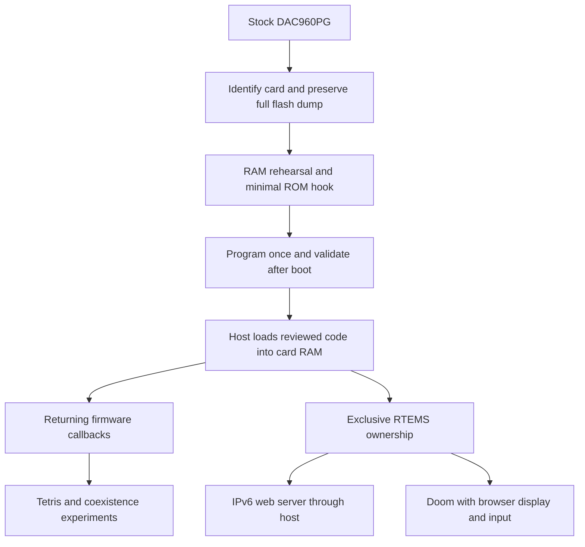

# From a stock card to applications

This is the reproducible route through the accepted experiments, not a command
to run every historical test. Start at the first stage your card has not passed.
Commands below run from this repository's root unless stated otherwise.



Firmware coexistence and exclusive RTEMS are distinct execution paths. Preserve
both; changing the application does not normally require another flash write.

## 0. Prepare and identify

The accepted board is a DAC960PG, i960RP, PCI `1069:0010`, 16 MiB DRAM,
firmware 4.07-0-29. The historical BDF is `0000:37:09.1`; discover the actual BDF
on a new machine. Preserve its identification, firmware and memory profile.
[Other cards require a port](porting.md), not substitution of an address.

Use Linux with matching kernel headers for transport modules. The toolchain
is GCC 3.3.6/binutils 2.27 with the project's i960 changes: use the
[preserved toolchain](../artifacts/toolchain-20261011/README.md),
[toolchain script](../toolchain.sh) and [original manual](project/MANUAL.md).
RTEMS and Doom source archives have pinned identities in their build guides.
On a checkout with preserved artifacts, verify them first:

```sh
python3 host/audit/artifacts.py --check-git
```

Before hardware work, identify the bound driver and active owner. Stop that
owner normally. A retained uncertain `dac960auto` session is not free hardware;
archive evidence and follow the recovery procedure rather than force unloading.

## 1. Preserve the original firmware

Follow [dump implementation](../host/dump/README.md) and
[snapshot recovery](firmware/SNAPSHOT-RECOVERY.md). Keep the paired full 512 KiB image,
extracted regions and independent vendor references. The
[ROM inventory](../artifacts/ROM-INVENTORY.md) contains our originals.
A vendor main-firmware payload is not a full card backup; an arbitrary staging
buffer is not automatically a fresh physical flash read.

Success: paired image identity, valid layout/IBR and independent region matches,
with the capture's source and limits recorded. Our route and dead ends are in
[ROM dump worklog](../artifacts/ROM-DUMP-WORKLOG.md).

## 2. Install the minimal firmware extension once

Read [firmware subproject](../subprojects/firmware/README.md), then the
[preflight](firmware/PROGRAMMING-PREFLIGHT.md) and
[one-shot programming contract](../host/program/README.md). Rebuild the ROM hook,
rehearse the candidate in RAM, and preserve complete restoration evidence before
programming. Enabled module insertion starts programming; use its documented
activation guard intentionally. Recovery was not validated in our experiments.

Success: the single programming transaction and both full fresh readbacks pass,
then a separate postboot validation proves the installed 0x6F handler. Our exact
result is [FIRMWARE-PROGRAMMED](firmware/FIRMWARE-PROGRAMMED.md).
**Already patched cards skip programming and use postboot validation.**

## 3. Prove a small RAM program

Use the [software-loader build/run recipe](loader/SOFTWARE-LOADER.md#build-and-run).
It builds the target payload and a module for the running Linux kernel, then
executes Fibonacci and checks the result. No additional flash write is required.

Success: expected scalar result, paired readbacks and full restoration, then
clean ownership release. Extend to [BIO1](loader/BUFFER-IO.md) and
[persistent sessions](loader/PERSISTENT-SESSION.md) only after this baseline passes.

## 4. Choose Tetris or RTEMS

[Tetris](../subprojects/tetris/README.md) is the shortest route to a usable
application: rebuild the payload/frontend from the accepted T4/T5 evidence and
use an SSH terminal. It does not pass through RTEMS.

For OS applications, follow [RTEMS](../subprojects/rtems/README.md). The original
bounded/session/net profiles prove returning tasks and networking. The autonomous
web profile adds hardware-clock progress; resident profiles establish exclusive
ownership, interrupt/STOP lifetime and larger memory. Profile names describe
different contracts, not simply higher version numbers.

Success: use the selected profile's native checks, physical admission/restoration
checks and exact generated payload/module pair. The larger Doom runtime requires
its owned-memory and lifecycle contracts, not the original 64 KiB scalar ABI.

## 5. Run the web server or Doom

[Web server](../subprojects/web/README.md) gives the accepted deployment path for
IPv6 HTTP and system information. Keep the relay, network configuration journal
and normal cleanup together. Local reachability does not establish outside-LAN
reachability.

[Doom](../subprojects/doom/README.md) uses DoomGeneric, Freedoom and the 8 MiB
arena. The [visible baseline](../artifacts/doom-visible-20261013/README.md) contains
exact `build.sh`, `live.sh` and replay scripts. Those scripts contain historical
workspace paths: recreate their pinned inputs in a fresh workspace or update
paths in a new script, never edit the archived original. Keep the point-side
compiler workaround and native comparison. The baseline is a two-frame proof;
the [interactive guide](../game/doom/play/README.md) provides the new fresh-workspace build and browser launcher. Consult its dated physical findings before treating a new build as accepted.

## Record a repeat

Retain exact input identities, source revision, target image, Linux module,
commands, host boot/profile, results and cleanup state in a new artifact batch.
Add its README and checksum inventory. Distinguish “built,” “native-tested,”
“ran on card,” “restored,” and “playable”; none implies all the others.
