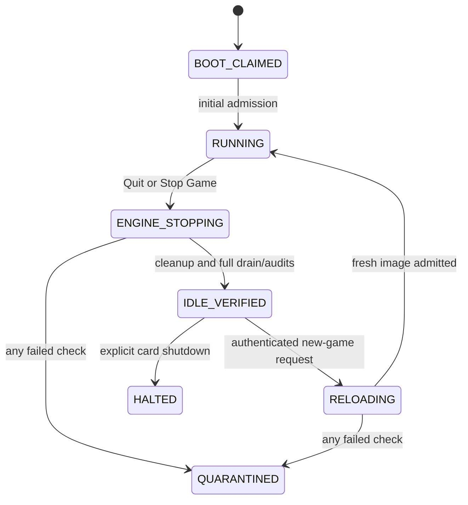

# Reusing the exclusive card session after Doom exits

**Implementation update:** the opt-in RTEMS idle/rearm kernel and retained
host/browser owner now pass physical STOP / reload / menu Quit / reload /
STOP: 65/43/65 frames, both rearms, 96 paired PIO frames and all stale gates.
Both final post-reset flash reads now pass. Positive browser/CLI idle
restart and host-loss gates remain;
the installed accepted bundle is unchanged. See [candidate status and exact card test](../../../../../artifacts/current/doom-rearm-20261018/README.md).

Investigation result: **feasible without returning to stock firmware or
releasing the pinned DMA mappings**, but not enabled in the installed kernel.
The current terminal `QUIE` state has already stopped the RTEMS timer, masked
interrupts and entered an infinite loop. Clearing the host STOP word cannot
resume that loop. One reset is still needed to install a kernel with a
reusable idle state; no flash patch is required for that next kernel.

## What was measured

The live control-page snapshot on boot
`31291627-dcd0-44bd-9c81-50708c818d80` shows global STOP acknowledged,
`QUIE`, no reported fault, 1,565 drained DMA frames and a heartbeat unchanged
at 15,733 over two samples. Only the PCI window selector was changed and
restored to `c0000000`; no card command or RAM/flash write was issued. The
old card stayed unbound. See [evidence](../../../../../artifacts/current/doom-reuse-investigation-20261018/README.md).

A host32 experiment loads the **actual accepted persistent Doom/private
Newlib object**, rather than a mock engine, as a local shared library. It
executes three games in **one process, one guarded 0x7e0000-byte arena and
the same seven pinned allocations**, with the engine entry remapped at the
same address on every load:

| Epoch | Exit | Frames | WAD reads |
| --- | --- | ---: | ---: |
| 1 | Owned STOP | 64 | 5,045 |
| 2 | Doom F10/Y menu Quit | 42 | 5,047 |
| 3 | Owned STOP | 64 | 5,045 |

Every epoch matches all first 32 pixel/palette blocks exactly, releases the
zone loan and all dynamic allocations, and preserves the original seven
allocation handles, generations, sizes and pins. The outer heap and loan
sequence are never reinitialized. Attempting to enter the **retired image
again without reload returns rejection**. The plain run and an ASan/UBSan
run of the outer driver/heap/arena both pass. The shared engine itself is
the existing uninstrumented host object; these results do not test i960
instruction-cache coherency, RTEMS IRQ continuations or real DMA reuse.
Linux's loader performs the native data/BSS refresh. The card implementation
must instead upload its trusted template and relocate it through admission.
The native module is mapped outside the arena; the fixed 900,000-byte image
budget allocation remains pinned. This is not a hardware image-overwrite or
DMA test.

## Proposed production lifecycle



Keep a **single owning host daemon** and one RTEMS instance for the boot.
Keep the original exclusive grant, seven fixed allocations, PCI driver,
host mappings and DMA descriptors. Normal menu Quit and the browser Stop Game
button park only Doom. The existing global RTEMS STOP becomes explicit card
shutdown or the failure path and continues to require reset. A host-daemon
crash remains a quarantine/reset case initially; a new process must not
adopt retained ownership merely because the debugfs files still exist.

Before declaring `IDLE_VERIFIED`, require all of the following:

1. The engine has returned through the expected 210/cleanup boundary, its
   zone loan and every dynamic allocation/borrow are gone, all guards pass,
   and the seven fixed allocation records are unchanged. Preserve arena
   generations: **never call `arena_init()` over the retained arena**.
2. DMA0 has the existing hardware completion/drain proof, not just a cleared
   software busy bit. Every published frame has been captured, checked and
   exactly ACKed. Both coherent-buffer guards and DMA1/2 peer registers pass.
   Keep mappings pinned throughout; never unload/reallocate the pin module.
3. The final frame, relocated text, relocation metadata, loader/kernel,
   stock lower-bank/allocator records and restored LMT cache map pass their
   existing audits. No WAD request or reply is pending.
4. The Init task has returned out of the engine call chain. Its own IRQ
   continuation is not live and its lifetime counters balance. Check every
   IRQ stack guard and owner invariant. Other RTEMS threads may legitimately
   retain IRQ continuations in unchanged kernel stacks; do not zero those
   stacks or equate their suspended state with engine ownership. If the gate
   cannot establish this safely, explicitly park workers and drain them in
   a bounded transition before allowing reuse.

Only the owning Init task can accept `REARM(expected_run, expected_last_frame,
expected_wad_seq, next_run)`, with monotonic non-wrapping run IDs. After that
gate, clear game-specific adapter state, upload the **original zero-based
template including its zero BSS gap**, verify exact SHA/geometry, apply
relocations exactly once, invalidate the instruction cache, bind a fresh
runtime and enter. Reloading only `.bss`, clearing `engine_invoked`, or
calling `doom_engine_entry()` again leaves initialized data/Newlib/retired
state wrong. Applying relocation again to an already relocated word is also
invalid. Do not rebuild RTEMS, rerun the full-bank pattern probe or return
to stock firmware during this transition.

## Rejecting stale transport state

Prefer keeping **transport counters monotonic across games**, outside the
reloaded engine. Doom's local frame number may restart at 1; it must be
distinct from the global DMA completion generation. Preserve the completed
descriptor state and `dma_completed` so the next `dma_kick()` verifies the
real previous completion rather than pretending DMA has never run. Slot
choice follows the engine's local alternating source buffers; after a game
ending on an odd frame, it must not be inferred from global generation
parity. Change that check on both host and card together.

Preserve bridge-command and WAD request sequences. A reply or ACK from the
prior game must never satisfy a request in the next game. Tag browser input
and restart requests with the game run ID, clear the host held-key queue, and
explicitly classify any one outstanding old-game mailbox event as discarded.
The latest real Quit left Y-up at sequence 98 after the engine consumed 97;
blindly resetting `key_seen` to zero or forwarding that old event is wrong.
Log discarded events separately from engine-consumed ACKs. Refresh browser
frame identity for the new game while continuing to serve immutable host
copies; no HTTP request should read a DMA destination after ACK.

Move the host-heartbeat watchdog into the outer RTEMS control loop as well
as engine callbacks, so daemon loss is bounded while idle or uploading.
Keep the existing DMA/ACK/WAD deadlines, marker validation and full owner
audits. One boot-level pre-flash pair and a final post-reset pair bracket
the entire reusable session. Do not call the stock mailbox READIMAGE while
the exclusive RTEMS callback is still running; per-game audits cover the
owned runtime and image instead.

## Next hardware gate

Implement a distinct, opt-in reusable kernel/control protocol, preserving the
installed accepted persistent bundle. First run a small relocated code/data/
BSS probe twice from the same seven fixed allocations, with deliberate stale
run/ACK/WAD/key/rearm rejection and a leaked-loan refusal. Then run actual
`STOP -> rearm -> Quit -> rearm -> STOP` Doom cycles. Capture complete paired
PIO/DMA frames after every admission, final per-game audits, stale completions,
idle heartbeat loss, stalled-host paths and final global quiescence. Close
with paired post-reset stock-flash reads before changing the ordinary launcher.
Restart still loads the WAD cache afresh initially; warm-cache reuse is a
separate optimization and is not part of this proof.

Linux exposes only **`pm`** in this device's `reset_method` file. No PM reset
was attempted. Existence of that method does not prove firmware reboot,
mailbox-ring reset or driver reattachment is safe with retained buffers.
A reset-aware driver/coordinator would be a separate investigation. A bus
reset would also affect the neighboring old card and is outside this route.

Native reproduction on the Linux host:

```sh
python3 game/doom/play/accele160/reuse/test_native.py \
  --platform /home/mit/i960-doom-persistent-20261018/build/platform-host \
  --wad /home/mit/i960-runtime-entry-20261012/freedoom1.wad \
  --out /home/mit/doom-reuse-native-new --sanitize
```
